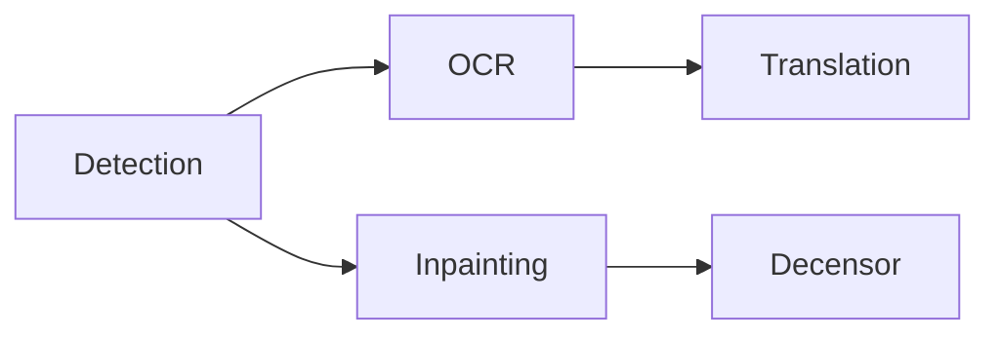

The processing selector above the canvas controls the page scope and stages. Start with the smallest scope that covers the work.

## Choose a scope

<Tabs>
  <Tab title='Current page'>Process the page currently shown on the canvas.</Tab>
  <Tab title='Selected pages'>Process the pages selected in the page rail.</Tab>
  <Tab title='Entire project'>Process every page in project order.</Tab>
  <Tab title='Selected layers'>
    Choose **Process → Process Selected Layers** after editing or adding a few text elements. It
    runs OCR and translation on the selected layers only.
  </Tab>
</Tabs>

Translation proceeds in page order using prior project text for continuity. Selected-layer translation also uses earlier speech and narration on the same page. The Translate dropdown provides the source language, target language, and instructions without leaving the canvas.

## Choose stages

Select any non-empty set of stages, then choose **Run**. Selected stages follow this dependency order:

Detection creates regions and removal masks. OCR reads those regions. Translation writes target text. Inpainting reconstructs artwork under the lettering. Decensor reconstructs artwork beneath user-painted censor masks. Select any non-empty subset of these five stages.

<Note>
  Omitted prerequisites are not added automatically. Include detection or OCR when a later stage
  needs fresh input. Choosing only inpainting does not also run detection, OCR, or translation.
</Note>

The command bar provides **Detection**, **OCR**, **Inpaint**, **Translate**, and **Decensor** shortcuts. Each shortcut runs only that stage on the selected pages. Use the processing selector and **Run** to execute all five stages or a chosen subset at the selected scope. **Decensor** alone processes existing censor masks without rerunning earlier stages.

## Follow progress and stop work

Only one processing job runs at a time, and pages cannot be imported while one is running. The activity center shows the stage, model, progress, and failures.

Each stage commits when it finishes. Completed work remains available if a later stage fails. Stopping prevents new work from starting; a native call already in progress returns at a safe boundary. Its result is discarded if stop was requested before the commit.

Stages with no applicable input complete without inference, although the model is still loaded first. A page with no detected text does not need OCR or translation.

<Warning>
  Rerunning a stage does not discard your edits. Detection skips any page that already has a text
  region, so delete the existing regions to detect a page again. OCR and translation replace
  generated text but keep source text and translations you edited. Inpainting skips a page that
  already has a cleanup layer unless you paint a new **Remove** mask.
</Warning>

Continue with [text review](/en/guides/review) or [cleanup](/en/guides/cleanup).
